# FlexQL Design Document

**GitHub Repository:** [https://github.com/psykat1116/FlexQL](https://github.com/psykat1116/FlexQL)
FlexQL is a custom, multithreaded relational database management system (RDBMS) written in C++17. It operates on a client-server architecture using TCP sockets and a custom binary wire protocol. The engine supports standard SQL operations (DDL and DML), custom row-level expiration (TTL), B+ Tree indexing for primary keys, an application-level LRU page cache, and AND-chained WHERE predicates with full index acceleration for range queries.

---

## 1. High-Level Architecture

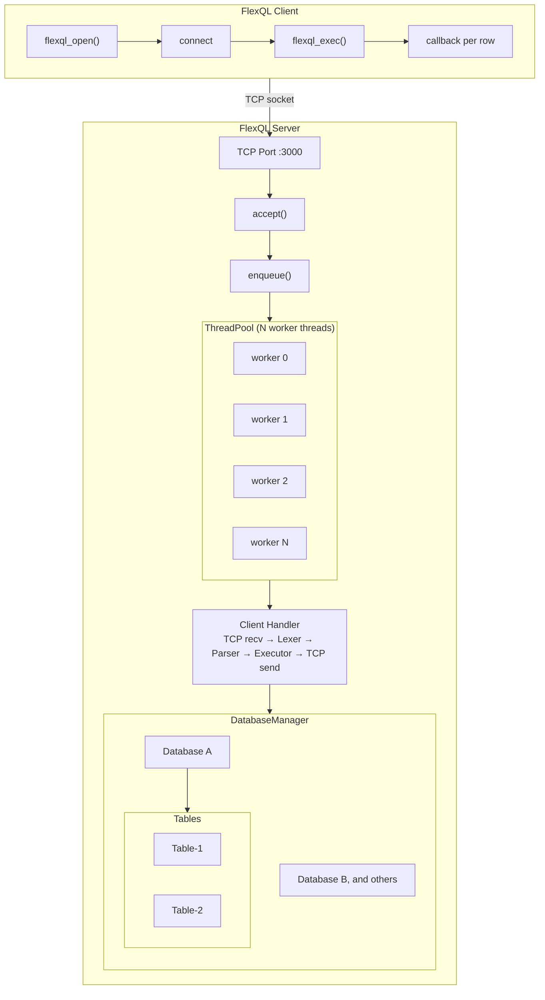

---

## 2. Compilation and Execution Instructions

### Requirements

- C++17-compatible compiler: GCC 9+ or Clang 10+
- POSIX system: Linux or macOS
- No external libraries — fully self-contained

### Example session

```sql
CREATE DATABASE mydb;
USE mydb;
CREATE TABLE users (id INT PRIMARY KEY, name VARCHAR(100), score DECIMAL);
INSERT INTO users VALUES (1, 'Alice', 98.5);
INSERT INTO users VALUES (2, 'Bob',   72.0) EXPIRY 3600;
SELECT * FROM users WHERE id = 1;
SELECT * FROM users WHERE id > 10 AND id < 20;
SELECT * FROM users WHERE score > 80 ORDER BY score;
```

### Graceful shutdown

Press `Ctrl+C`. The server flushes all dirty cache pages and saves the B+ Tree index to disk before exiting.

---

## 3. Data Storage

### 3.1 On-Disk File Structure

Each table is backed by exactly three files:

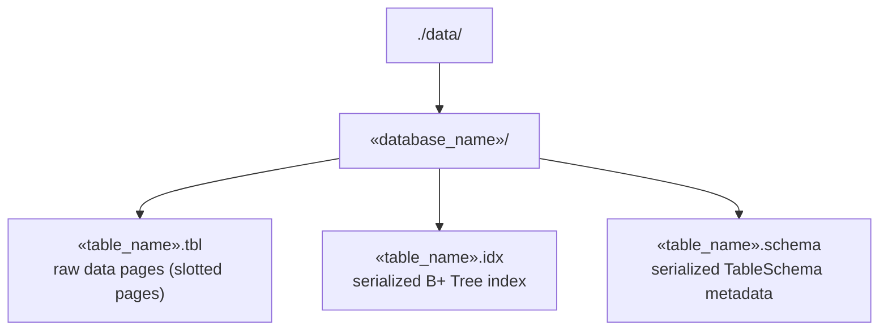

### 3.2 Slotted Page Layout (16 KB per page)

Every `.tbl` file is a flat sequence of fixed-size 16 KB pages. Each page uses a slotted-page architecture: the header and slot directory grow forwards from offset 0, while row data grows backwards from the end of the page. Free space sits in the middle.

```mermaid
flowchart TB
    subgraph Page["16 KB Page — offset 0 (left) → offset PAGE_SIZE-1 (right)"]
        direction LR
        H["PageHeader<br/>12 bytes"] --> SD["Slot Directory<br/>(grows →)"] --> FS["Free Space"] --> RD["Row Data<br/>(← grows)"]
    end

    subgraph PageHeader["PageHeader (packed, 12 bytes)"]
        direction LR
        PID["page_id<br/>uint32"] --> NP["next_page<br/>uint32"] --> NS["num_slots<br/>uint16"] --> FO["free_space_off<br/>uint16"] --> FL["flags<br/>uint8"] --> PAD["pad<br/>[3]"]
    end

    subgraph SlotEntry["SlotEntry (4 bytes, one per row)"]
        direction LR
        OFF["offset<br/>uint16"] -->|"byte offset into row data area"| LEN["length<br/>uint16"]
    end
```

A new page is allocated when the current last page has insufficient free space for the incoming row. Pages are pre-allocated in chunks of 256 (`PREALLOC_PAGES`) using `ftruncate` to reduce filesystem overhead during bulk inserts.

### 3.3 Row Binary Serialization

Rows are serialized into dense binary format in schema column order. Each field is encoded as:

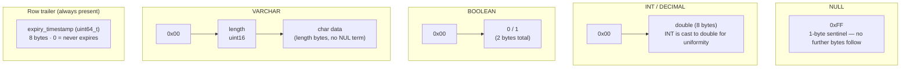

### 3.4 Schema Serialization

`TableSchema` (a fixed-size C struct, max 32 columns × 64-char names) is written as a raw binary blob to the `.schema` file at `CREATE TABLE` time and memory-mapped on every subsequent open. It is held in memory for the lifetime of the `TableManager` instance.

---

## 4. Indexing Method

### 4.1 Structure

The engine maintains a B+ Tree on every table's integer primary key, implemented using a `std::map<int32_t, IndexRecord>` in `bplus_tree.h`. Each entry maps a primary key value to an `IndexRecord { page_id, slot_idx }` — the exact physical location of the row.

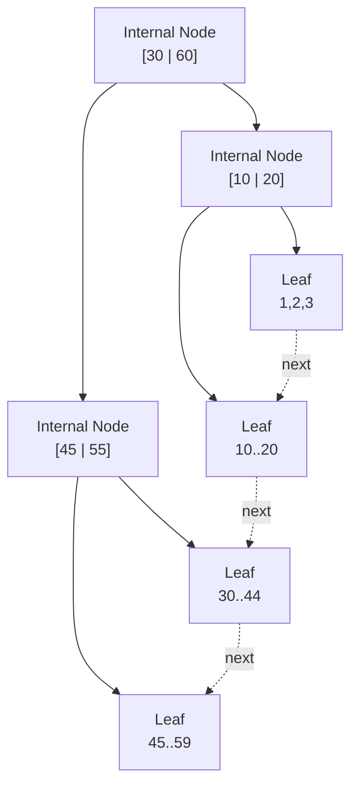

Each leaf entry: `{ key: int32, page_id: uint32, slot_idx: uint16 }`

The index is serialized to the `.idx` file on every clean shutdown and loaded back on startup. If the `.idx` file is absent (e.g. after a crash during bulk load), `Rebuild_Index()` reconstructs it by scanning the raw `.tbl` pages and immediately saves it so subsequent restarts are fast.

### 4.2 Three Query Paths

The executor analyses `where_list` before choosing how to execute a SELECT:

**Path 1 — Point lookup** (`WHERE pk = X`): single `std::map::find`, O(log N). One page fetched.

```sql
WHERE id = 42
  → btree.Find_Key(42) → IndexRecord { page_id=7, slot_idx=3 }
  → Fetch_Page(7) → getRow(3) → Deserialize → done
```

**Path 2 — Range scan** (`WHERE pk OP val [AND pk OP val]`): uses `std::map::lower_bound` / `upper_bound` to iterate only the matching leaf entries. Cost is O(log N + K) where K is the result count. Zero pages outside the result set are read.

```sql
WHERE id > 10 AND id < 20
  → bounds: lo=10 (exclusive), hi=20 (exclusive)
  → btree.Find_Range(10, false, 20, false)
  → upper_bound(10) .. first key >= 20  →  9 IndexRecords
  → fetch only those 9 rows

WHERE id < 50
  → bounds: lo=INT32_MIN (open), hi=50 (exclusive)
  → (lo != INT32_MIN || hi != INT32_MAX) = TRUE  → index fires
  → map::begin() .. upper_bound(49)  →  49 IndexRecords
```

**Path 3 — Full scan**: used when the WHERE references a non-PK column, uses `!=`, or there is no WHERE clause. Iterates every page and applies `Row_Matches_All(where_list)` to each row.

```sql
WHERE status = 'open'
  → all_on_pk = false  →  tm->Scan() over all pages
  → Row_Matches_All checks every AND condition per row
```

---

## 5. Caching Strategy

### 5.1 LRU Page Cache

An application-level LRU cache (`lru_cache.h`) sits between the executor and raw disk I/O. It holds up to **4,096 pages (64 MB per table)** in memory. Eviction uses a doubly-linked list + hash map for O(1) get/put/evict.

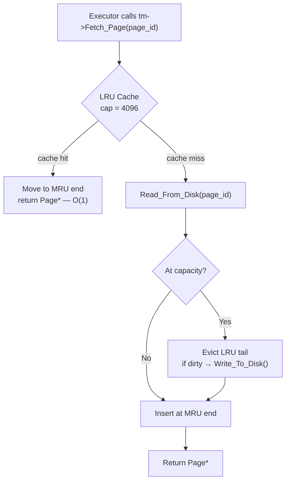

### 5.2 Dirty Tracking and Write-Back

Pages are only written to disk when evicted from the cache (write-back policy) or when `Flush_Table()` is called on shutdown / `Ctrl+C`. This means sequential inserts only touch the disk when the cache fills, not on every row. A page is marked dirty by `cache.Mark_Dirty(pid)` immediately after any write to its slots.

### 5.3 Cache Interaction with Range Queries

For B+ Tree range scans, only the pages that actually hold matching rows are fetched. A query returning K rows touches at most K pages (often fewer if multiple rows share a page). For a full scan, all `number_of_pages` pages pass through the cache; recently accessed pages benefit from cache hits on repeated queries.

---

## 6. Handling of Expiration Timestamps

Every row carries a `uint64_t expiry_timestamp` field serialized as the last 8 bytes of the row. A value of `0` means the row never expires.

### 6.1 Setting Expiry

The `EXPIRY N` clause in INSERT sets the timestamp to `now() + N seconds` at insert time:

```sql
INSERT INTO sessions VALUES (1, 'token_abc') EXPIRY 3600;
```

`Make_Expiry(secs)` in `expiry.h` computes `steady_clock::now() + secs` as a Unix timestamp and stores it in `Row::expiry_timestamp`.

### 6.2 Lazy Evaluation at Read Time

Every read path checks expiry lazily, regardless of whether the background reaper (6.3) has run yet:

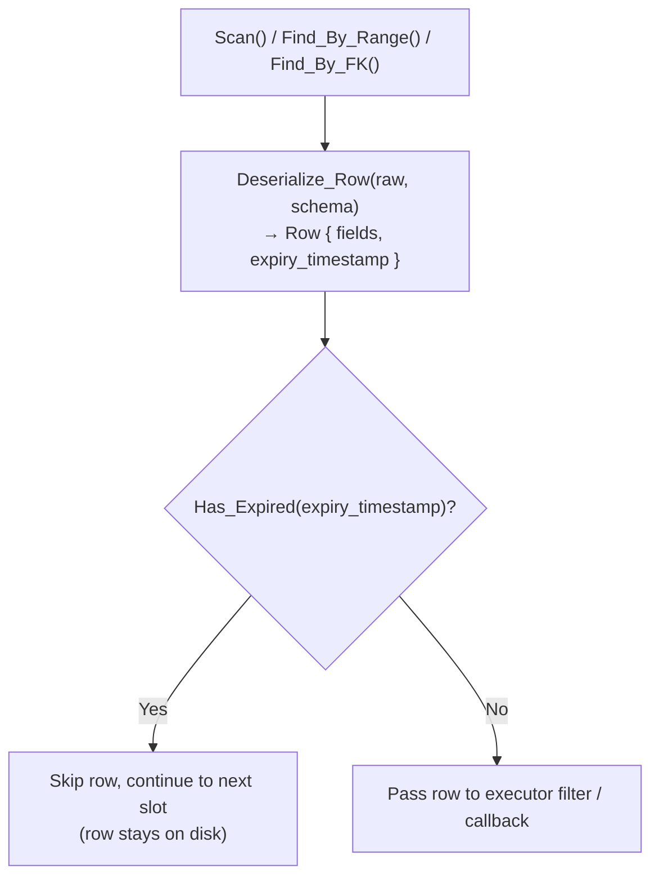

This design avoids write amplification on the read path — expired rows are never deleted just to satisfy a `SELECT`, they are simply made invisible to queries. Physical disk reclaim happens separately, via `DELETE`, a table rebuild, or the background reaper.

### 6.3 Background Reaper Thread

A dedicated thread, started in `main()` and detached, wakes on a fixed interval (default 30s, configurable via a third CLI argument to `flexql-server`, mainly for tests) and calls `DatabaseManager::Purge_Expired()`. This fans out through every currently-loaded `Database` and `TableManager` — `TableManager::Purge_Expired()` walks the raw pages directly (bypassing the lazy filter in `Scan()`), splits rows into survivors and expired, and rewrites the table file only if it actually found something to remove, reusing the same truncate-and-reinsert path as `Delete_Where`. Table and database locks (`table_mutex`, `tables_mutex`, `database_mutex`) are held the same way `Flush_DB_Manager` holds them, so a sweep is safe against concurrent inserts/selects.

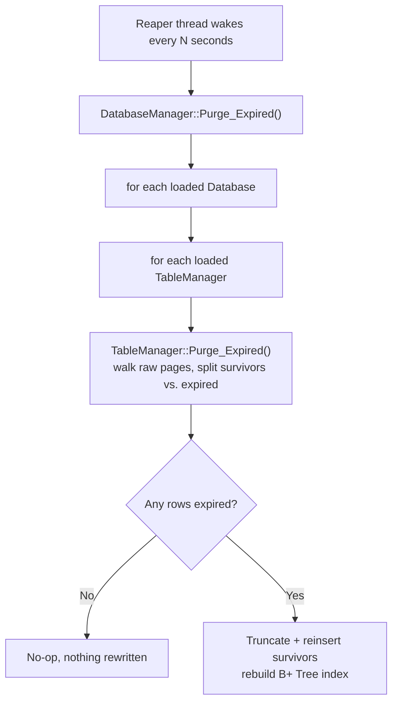

Only databases/tables that have been opened at least once (via `USE`) are swept — consistent with the engine's lazy-load design; nothing is force-loaded from disk just to check its TTLs.

---

## 7. Multithreading Design

### 7.1 Thread Pool Model

The server pre-creates a fixed pool of `N = max(hardware_concurrency, 4)` worker threads at startup. The main thread runs the `accept()` loop and pushes each accepted file descriptor into the pool's task queue via `enqueue()`. A sleeping worker wakes, pops the fd, and runs `handleClient()` for the lifetime of that connection — then loops back to wait for the next task.

```bash
main thread:
  listen()
  ThreadPool pool(N)              ← N workers pre-created, blocking on condvar
  loop:
    cfd = accept()
    pool.enqueue([cfd]{ handleClient(cfd, mgr); })

each worker thread (steady loop):
  wait on condition_variable
  pop fd from queue
  while (true):
    recv MSG_QUERY
    t_start = steady_clock::now()
    Lexer → Parser → Executor → send rows
    send MSG_STATUS with elapsed time
  close(fd)
  ← back to waiting
```

**Why a pool instead of `detach()`:**

- Thread creation (~100 µs) is paid once at startup, not per connection.
- The pool provides natural back-pressure: if all workers are busy, new fds wait in the queue rather than spawning unbounded threads that could exhaust system resources.
- Clean shutdown: the `ThreadPool` destructor sets `stop = true`, `notify_all()`, and `join()`s every worker — no dangling threads at `Ctrl+C`.

### 7.2 Locking Hierarchy

Shared state is protected at three levels. The lock ordering is always top-to-bottom — `database_mutex` before `tables_mutex` before `table_mutex` — which prevents deadlocks.

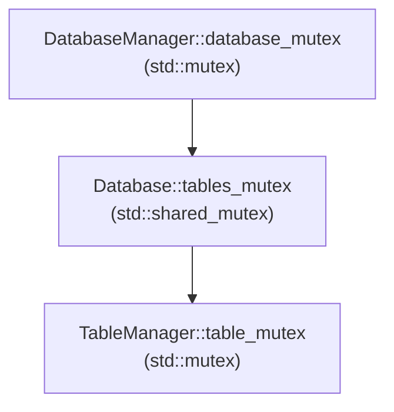

- **`DatabaseManager::database_mutex`** — held for the entire body of `Create_Database`, `List_Databases`, and the two critical sections inside `Get_Database` (double-checked locking pattern: lookup → stat → re-lock → insert).
- **`Database::tables_mutex`** — `shared_lock` for `Table_Names`, schema lookup, and the `Get_Table` fast path; `unique_lock` for `Get_Table` lazy-load and `Execute_Create` insertion.
- **`TableManager::table_mutex`** — exclusive lock on every INSERT, DELETE, SELECT scan/lookup, and FLUSH (one query at a time per table; different tables are independent).

**Key correctness invariants:**

- `Create_Database` and `List_Databases` both hold `database_mutex` while touching the filesystem directory, preventing a concurrent create from racing a directory scan.
- `Table_Names` holds `tables_mutex` as a shared lock while scanning the `.schema` directory, preventing a concurrent `CREATE TABLE` from creating a partially-visible entry.
- `Get_Table` uses the double-checked pattern: fast path under `shared_lock`, slow path (lazy load from disk) under `unique_lock` with a re-check to prevent double-insertion.
- Multiple clients performing concurrent `SELECT` on the same table each hold `table_mutex` exclusively but in sequence — readers do not bypass the mutex. Concurrent reads on *different* tables are fully parallel.
- The `tables_mutex` `shared_lock` in `Flush_DB` ensures flushing can proceed concurrently with reads but blocks new table creation.

### 7.3 ThreadPool Implementation

`ThreadPool` (`include/worker/worker.h`, `src/worker/worker.cpp`) owns:

| Member                            | Role                                   |
| --------------------------------- | -------------------------------------- |
| `vector<thread> workers`        | Pre-created worker threads             |
| `queue<function<void()>> tasks` | Pending connection handlers            |
| `mutex queue_mutex`             | Protects the task queue                |
| `condition_variable cv`         | Workers sleep here when queue is empty |
| `atomic<bool> stop`             | Signals workers to drain and exit      |

`enqueue(fn)` locks `queue_mutex`, pushes the lambda, and calls `cv.notify_one()`. The woken worker pops the task under the same lock, releases it, then calls the lambda — so `handleClient` runs without holding the queue lock, allowing other workers to accept new tasks concurrently.

### 7.4 Signal Handling

`SIGINT` and `SIGTERM` set `global_stop = true` and call `DatabaseManager::Flush_DB_Manager()`, which acquires each table's mutex, flushes dirty pages, and saves the B+ Tree index before `exit(0)`. The `ThreadPool` destructor fires as part of stack unwinding before `exit`, joining all workers cleanly. `SIGPIPE` is ignored so a client disconnect does not terminate the server.

---

## 8. Query Execution Workflow

Every query follows a strict pipeline from client → network → parse → execute → storage → response.

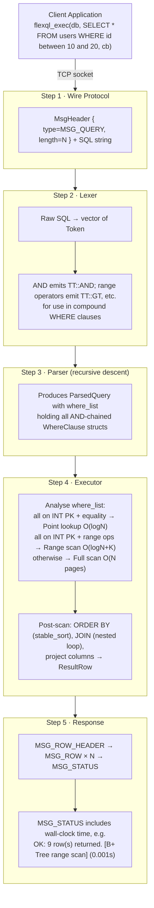

---

## 9. Additional Design Decisions

### 9.1 No Nagle's Algorithm

`TCP_NODELAY` is set on every client socket. This ensures each `MSG_ROW` packet is sent immediately rather than being held by the kernel waiting to coalesce with subsequent data. For queries returning many rows this eliminates up to 40 ms of artificial latency per row group.

### 9.2 File Pre-allocation

When a new page is needed, `ftruncate` extends the `.tbl` file by `PREALLOC_PAGES = 256` pages (4 MB) at once rather than one page at a time. This reduces filesystem metadata overhead during bulk inserts. On shutdown, the file is trimmed back to `number_of_pages * PAGE_SIZE`.

### 9.3 Compound WHERE with AND

The parser was extended to support multiple AND-chained predicates. All conditions are stored in `ParsedQuery::where_list`. The executor uses this list both to classify the query path (deriving tightest PK bounds for range scans) and to filter rows in the full-scan path via `Row_Matches_All()`. A query like `WHERE id > 10 AND id < 20` triggers a single B+ Tree range scan, not two separate passes.

### 9.4 Index Auto-Rebuild After Unclean Shutdown

If the server is killed during a bulk insert (before the first `Ctrl+C` flush), the `.idx` file may not exist on the next startup. The `TableManager` constructor detects this and calls `Rebuild_Index()`, which scans the raw `.tbl` pages to reconstruct the B+ Tree entirely in memory, then immediately saves it. This means the first query after a crash may be slower (O(N pages) rebuild), but all subsequent queries use the index normally.

### 9.5 Thread Pool Sizing

The pool size defaults to `max(std::thread::hardware_concurrency(), 4)`. The minimum of 4 guards against environments that report 0 or 1 logical CPUs. Since `handleClient` is I/O-bound (network reads, disk reads through the page cache), it spends most of its time blocked in `pread`/`pwrite`/`recv`/`send` — all of which release the CPU. A pool of `hardware_concurrency` threads is therefore sufficient to keep all cores busy without the overhead of fine-grained I/O concurrency primitives. The value can be adjusted at `main.cpp:num_threads` without any other changes.

### 9.6 Execution Time Reporting

`std::chrono::steady_clock` is started immediately before the query pipeline in `main.cpp` and stopped after execution. The elapsed duration in seconds (formatted to 3 decimal places) is appended to every `OK` status message. This makes performance visible directly in the REPL without external tooling.

---

## 10. Component Dependency Map

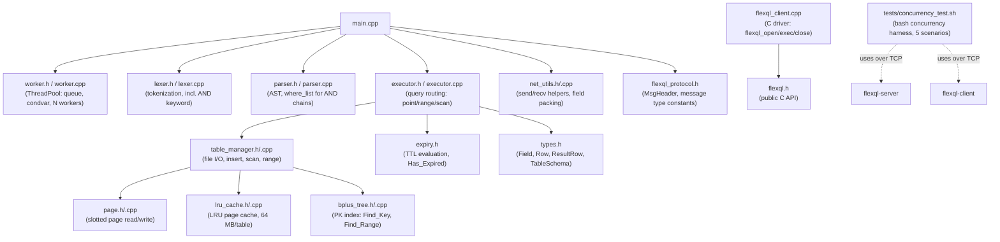
