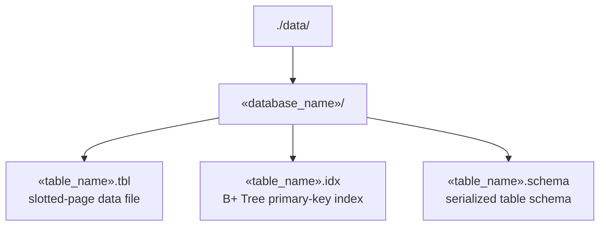

# FlexQL

**Github Repository:** [https://github.com/psykat1116/FlexQL](https://github.com/psykat1116/FlexQL)
A custom multithreaded relational database engine written in C++17, featuring a client-server architecture over TCP, a custom binary wire protocol, a pre-allocated thread pool for connection handling, slotted-page storage, LRU page cache, B+ Tree primary-key indexing, and row-level TTL expiration.

---

## Requirements

- C++17-compatible compiler (GCC 9+ or Clang 10+)
- POSIX system (Linux or macOS)
- `make` or direct `g++` invocation
- No external dependencies the entire engine is self-contained

---

## Building

Compile all server-side and client side translation units together:

```bash
make
```

---

## Running

### Start the server

```bash
./bin/flexql-server [port] [data directory] [reaper interval seconds]
```

On startup you will see:

```
+------------------------------------------+
|  FlexQL Server - PORT 3000               |
|  Thread pool: 8 worker(s)                |
|  TTL reaper: every 30s                   |
|  Ctrl + C to stop.                       |
+------------------------------------------+
```

The thread count is `max(hardware_concurrency, 4)` and is shown at startup.

A background thread sweeps expired rows (`INSERT ... EXPIRY N`) every 30s by default pass a third argument to change the interval (mainly useful for tests, e.g. `./bin/flexql-server 3000 ./database 2`).

Press **Ctrl+C** to initiate a graceful shutdown. All dirty cache pages are flushed to disk before exit.

### Interactive REPL

With the server running, open a second terminal and launch the REPL. Default the host is `127.0.0.1` and port is `3000`

```bash
./bin/flexql-client [host] [port]
```

The REPL connects to `localhost:3000` by default. You can then type SQL statements directly:

```sql
CREATE DATABASE mydb;
USE mydb;
CREATE TABLE users (id INT PRIMARY KEY, name VARCHAR(100), score DECIMAL);
INSERT INTO users VALUES (1, 'Alice', 98.5);
INSERT INTO users VALUES (2, 'Bob', 72.0) EXPIRY 3600;
SELECT * FROM users;
SELECT * FROM users WHERE id = 1;
SELECT name, score FROM users WHERE score > 80 ORDER BY score;
```

Type `.exit` or `.quit` to close the REPL session.

### Run benchmark

```bash
make benchmark
./bin/flexql-benchmark             # 10 M row insertion + unit tests
./bin/flexql-benchmark 500000      # custom row count
./bin/flexql-benchmark --unit-test # correctness tests only
```

### Benchmark results

Measured with `./bin/flexql-benchmark 1000000` (1M rows, single client, server + client on the same 8-core machine, `-O3` build).

| Operation                                     | Rows      | Time    | Throughput                 |
| --------------------------------------------- | --------- | ------- | -------------------------- |
| Batch INSERT (BENCH_USERS)                    | 1,000,000 | 6.54 s  | **152,951 rows/sec** |
| Batch INSERT (BENCH_ORDERS, join table)       | 1,000,000 | 4.12 s  | **242,718 rows/sec** |
| Full table scan (`SELECT *`)                | 1,000,002 | 5.60 s  | 178,600 rows/sec           |
| Projection (`SELECT NAME, EMAIL`)           | 1,000,002 | 9.81 s  | 101,970 rows/sec           |
| Point lookup (`WHERE ID = 500000`)          | 1         | 91 ms   | —                         |
| Range filter (`WHERE BALANCE > 5000`)       | 599,900   | 6.81 s  | 88,090 rows/sec            |
| ORDER BY (ASC)                                | 1,000,002 | 12.11 s | 82,580 rows/sec            |
| ORDER BY (DESC)                               | 1,000,002 | 12.34 s | 81,070 rows/sec            |
| INNER JOIN (2 tables, full)                   | 1,000,000 | 13.48 s | 74,180 rows/sec            |
| INNER JOIN (filtered,`WHERE AMOUNT > 2500`) | 500,000   | 9.40 s  | 53,180 rows/sec            |

Reproduce with:

```bash
make all && make benchmark
./bin/flexql-server 3000 ./database &
./bin/flexql-benchmark 1000000
```

### Run concurrency test

Verifies the thread pool handles concurrent connections correctly including concurrent `CREATE DATABASE`, isolated parallel writes, concurrent reads, mixed read/write workloads, and the background TTL reaper.

```bash
bash tests/concurrency_test.sh        # 32 concurrent clients (default)
bash tests/concurrency_test.sh 100    # custom client count
```

The script builds the project, starts a server on port 3099 (with a fast 2s TTL-reaper interval just for the test run), runs five test scenarios, reports pass/fail per scenario, and cleans up automatically:

1. Concurrent `CREATE DATABASE` (same name, all clients at once)
2. Concurrent isolated writes each client owns its own database
3. Concurrent reads on a shared table
4. Mixed concurrent read/write workload
5. TTL reaper inserts a short-lived row, waits past its expiry, and confirms the server log shows a background sweep (`[reaper] purged ...`), not just a lazily-filtered `SELECT`

Validated clean (all 5 scenarios passing, zero crashes/deadlocks) at up to **100 concurrent clients** 100/100 correct on concurrent `CREATE DATABASE`, isolated writes, shared-table reads, and a 50-writer/50-reader mixed workload.

---

## SQL Reference

### DDL

```sql
CREATE DATABASE <name>;
USE <name>;
SHOW DATABASES;
SHOW TABLES;

CREATE TABLE <name> (
    <col> INT [PRIMARY KEY] [NOT NULL],
    <col> DECIMAL,
    <col> VARCHAR(<n>),
    <col> BOOLEAN
);
```

### DML

```sql
INSERT INTO <table> VALUES (val1, val2, ...) [EXPIRY <seconds>];
SELECT [*|col1,col2,...] FROM <table>
    [WHERE <col> <op> <val> [AND <col> <op> <val> ...]]
    [ORDER BY <col> [ASC|DESC]];
SELECT ... FROM <t1> INNER JOIN <t2> ON <t1.col> = <t2.col>;
DELETE FROM <table> WHERE <col> <op> <val>;
```

`EXPIRY <seconds>` is an optional FlexQL extension that marks the row for automatic expiration N seconds after insertion. Expired rows are silently skipped on reads.

---

## Data directory layout



Each `.tbl` file is a flat sequence of 16 KB pages. The server loads this data lazily through the LRU page cache (up to 4,096 pages = 64 MB per table in memory at once).

---

## Configuration summary

| Parameter        | Default                          | How to change                           |
| ---------------- | -------------------------------- | --------------------------------------- |
| Port             | `3000`                         | First argument to`flexql-server`      |
| Data directory   | `./database`                   | Second argument to`flexql-server`     |
| Thread pool size | `max(hardware_concurrency, 4)` | Edit`main.cpp:num_threads`            |
| Page size        | `16384` B                      | Compile-time constant in`types.h`     |
| LRU cache size   | `4096` pages                   | Compile-time constant in`lru_cache.h` |
| Max columns      | `32`                           | `MAX_COLS` in `types.h`             |
| Max name length  | `64` chars                     | `MAX_NAME` in `types.h`             |

---

## Troubleshooting

**`bind() failed on port 3000`** the port is already in use. Either stop the existing process or start the server on a different port: `./bin/flexql-server 3001`.

**`Connection failed` in REPL or client** make sure the server is running before launching the client. Check that firewall rules allow the chosen port.

**Data not persisting after restart** confirm the data directory path is the same across invocations. The server prints the active data directory on startup.

**`ERROR: No database selected`** you must issue `USE <dbname>;` before running table-level queries. Use `SHOW DATABASES;` to list available databases.

---
